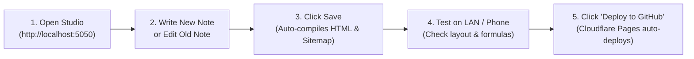

# shrtnotes - Website Management Studio & Platform

**shrtnotes** is an end-to-end static study notes publishing engine and local management application built for content creators who want to manage a website **without writing any code**.

---

## 🌟 What Is Built & Ready

1. **Python Management Studio (`app.py`)**:
   - Visual dashboard accessible in your web browser (`http://localhost:5050`) and across your local Wi-Fi network (LAN) so you can test on mobile devices.
   - **Write & Edit Notes**: Rich markdown editor with live KaTeX math formula rendering ($E=mc^2$).
   - **Edit Previous Notes**: Search and update any published note in seconds.
   - **Dynamic Hierarchy**: Create new subjects (Maths, Physics, Chemistry, Biology, Economics, etc.) with automated tree generation.
   - **Universal Design Controls**: Change brand colors, site titles, or fonts in one place; click save, and all pages update automatically.
   - **AdSense Management**: Manage zero-CLS ad slots (Header, In-Article, Sidebar, Footer) with compliance safeguards.
   - **1-Click GitHub Deploy**: Push updates to GitHub, which automatically triggers Cloudflare Pages edge deployment.

2. **Static Site Generator (`generator.py`)**:
   - Compiles notes into lightweight, responsive static HTML files inside the `site/` directory.
   - **100% SVG Vector Icons (Lucide)**: Absolutely zero emojis on the user-facing site.
   - **Zero-CLS Ad Containers**: Guaranteed layout stability so ads never overlap content or cause layout shifts.
   - **Auto-generated SEO**: Updates `sitemap.xml` and `robots.txt` on every single save.
   - **Schema.org Structured Data**: Generates `BreadcrumbList` and `TechArticle` JSON-LD for rich Google Search snippets.

3. **AdSense & Google Search Console Compliance Pages**:
   - `About Us`: Detailed mission, editorial process, and author credentials.
   - `Privacy Policy`: GDPR, CCPA, and Google AdSense DART cookie clauses.
   - `Terms and Conditions`: Educational terms of use.
   - `Contact Us`: Direct editorial feedback channels.
   - `Disclaimer`: Academic study and external links disclaimers.

---

## 🚀 How to Run the Management Studio

### On Linux / macOS
```bash
cd /home/jashwanth/.gemini/antigravity/scratch/shrtnotes
./run_studio.sh
```

### On Windows
Double-click `run_studio.bat` (or run it via Command Prompt).

The app will open at:
* **Local Computer**: `http://localhost:5050`
* **Mobile / LAN (Wi-Fi)**: `http://<your-lan-ip>:5050` (displayed right on the Studio sidebar!)

---

## 📲 Daily Workflow



1. **Open Studio**: Launch `./run_studio.sh` (or `run_studio.bat`).
2. **Write or Edit**: Go to **Write New Note** or pick any existing note from **All Notes**.
3. **Save**: Click **Save Note & Rebuild Site**. The system compiles the page, updates the category index, and recalculates `sitemap.xml`.
4. **LAN Preview**: Open the LAN link on your phone to verify mobile responsiveness.
5. **1-Click Deploy**: Go to **Deploy to GitHub** and click **Deploy Now**. Cloudflare Pages publishes your updates across edge servers worldwide in under 30 seconds.

---

## 🔗 Connecting to GitHub & Cloudflare Pages

To enable the 1-click deploy to your own GitHub repository:
1. Create a repository on GitHub (e.g. `shrtnotes`).
2. Link your local directory to GitHub by running once:
   ```bash
   git remote add origin https://github.com/<your-username>/shrtnotes.git
   git push -u origin main
   ```
3. In **Cloudflare Pages**:
   - Click **Create an Application** > **Pages** > **Connect to Git**.
   - Select your `shrtnotes` repository.
   - **Framework Preset**: None / Static HTML.
   - **Build Command**: *(Leave empty, as the Studio pre-compiles all HTML)*.
   - **Build Output Directory**: `site`
   - Click **Save and Deploy**.
4. Every subsequent time you click **Deploy to GitHub** inside the Python Studio, Cloudflare Pages will automatically update your live site!
