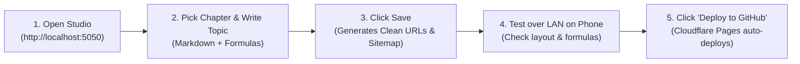

# shrtnotes - Website Management Studio & Platform

**shrtnotes** is an end-to-end static study notes publishing engine and local management application built for content creators who want to manage a website **without writing any code**.

---

## 🌟 What Is Built & Ready

1. **Chapter-Wise Hierarchy (`Subject -> Chapter -> Topic`)**:
   - Organize your notes logically:
     - **Subject** (e.g., Mathematics, Physics, Chemistry, Biology)
     - **Chapter** (e.g., Calculus, Thermodynamics, Cell Biology)
     - **Topic** (e.g., Fundamental Theorem of Calculus, Carnot Efficiency)
   - Easily add new chapters, edit chapter names/descriptions, and create topics under any chapter.

2. **Clean URLs (Zero `.html` Visible Anywhere)**:
   - Every page is compiled with Clean Directory URLs:
     - Home: `/`
     - Subject: `/mathematics/`
     - Chapter: `/mathematics/calculus/`
     - Topic: `/mathematics/calculus/calculus-fundamental-theorem/`
     - Legal Pages: `/about/`, `/privacy-policy/`, `/terms-and-conditions/`, `/contact/`, `/disclaimer/`
   - Sitemaps and links use 100% clean URLs without `.html`.

3. **Universal Multi-Platform Monetization**:
   - Switch between **Google AdSense**, **Media.net**, **Ezoic**, **Adsterra**, **Carbon**, or **Custom Sponsor Banners** at any time.
   - Paste global header scripts or custom HTML/JS code for:
     - Top Header Banner
     - In-Article (middle of content)
     - Sticky Sidebar
     - Bottom Footer
   - Also includes a built-in Google AdSense quick-setup mode.
   - All units are protected by zero-CLS (Cumulative Layout Shift) containers with subtle `ADVERTISEMENT` labels.

4. **Python Management Studio (`app.py`)**:
   - Visual dashboard accessible in your web browser (`http://localhost:5050`) and across your local Wi-Fi network (LAN) for mobile testing.
   - **Write & Edit Topics**: Rich markdown editor with dynamic chapter selection and live KaTeX math formula rendering ($E=mc^2$).
   - **Site Tree & Chapters**: Add and edit subjects, chapters, and custom SVG icons without writing code.
   - **1-Click GitHub Deploy**: Push updates to GitHub, which triggers Cloudflare Pages edge deployment.

---

## 🚀 How to Run the Management Studio

### On Linux / macOS
```bash
cd /home/jashwanth/.gemini/antigravity/scratch/shrtnotes
./run_studio.sh
```

### On Windows
Double-click `run_studio.bat` (or run it via Command Prompt).

The app will open at:
* **Local Computer**: `http://localhost:5050`
* **Mobile / LAN (Wi-Fi)**: `http://<your-lan-ip>:5050/preview/`

---

## 📲 Daily Workflow



1. **Open Studio**: Launch `./run_studio.sh` (or `run_studio.bat`).
2. **Write or Edit**: Go to **Write New Topic**, choose your Subject and Chapter, and type your notes.
3. **Save**: Click **Save Topic & Rebuild Clean URLs**. The system compiles the page and recalculates `sitemap.xml`.
4. **LAN Preview**: Open the LAN link on your phone to verify mobile responsiveness.
5. **1-Click Deploy**: Go to **Deploy to GitHub** and click **Deploy Now**. Cloudflare Pages publishes your updates across edge servers worldwide in seconds.
